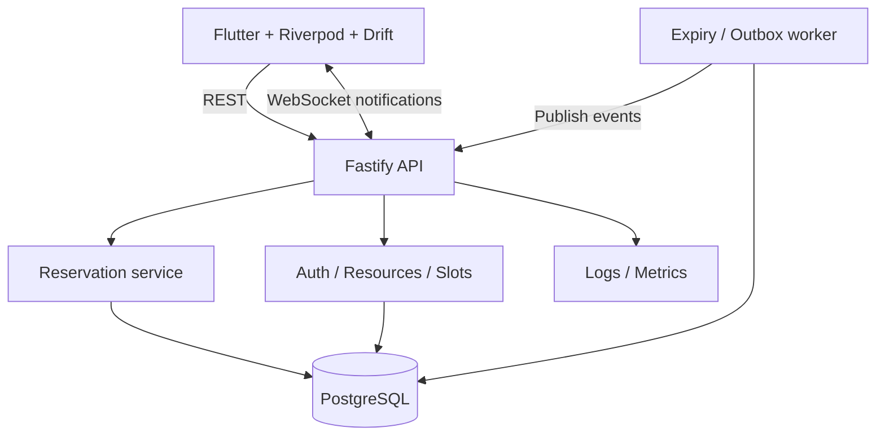

# Wobbii — System Architecture

## 1. Style

Start with a **modular monolith**: one Fastify API deployment, PostgreSQL as the source of truth, and a separately runnable worker when needed. Keep modules isolated through explicit service/repository boundaries.



For multi-instance WebSocket delivery, introduce a shared pub/sub mechanism rather than relying on in-process broadcasts.

## 2. Backend boundaries

- `auth`: sessions, credentials, permissions.
- `users`: user profile.
- `resources`: resource definitions and admin operations.
- `slots`: schedules and slot capacity.
- `reservations`: hold, confirm, cancel and status.
- `idempotency`: deduplication of mutations.
- `waitlist`: queue and promotion (P1).
- `events`: transactional outbox and event contracts (P1).
- `workers`: expiry and publication jobs (P1).
- `observability`: request context, logs and metrics.

Suggested layout:

```text
wobbii/
├── apps/
│   ├── api/
│   │   ├── src/
│   │   │   ├── modules/{auth,users,resources,slots,reservations,idempotency,waitlist,events}/
│   │   │   ├── infrastructure/{database,queues,websocket}/
│   │   │   ├── plugins/
│   │   │   ├── workers/
│   │   │   ├── app.ts
│   │   │   └── server.ts
│   │   └── tests/
│   └── mobile/lib/
│       ├── core/{network,storage,routing,errors}/
│       ├── features/{auth,resources,reservations,waitlist}/
│       └── shared/
├── packages/contracts/
├── infrastructure/
├── docs/
└── docker-compose.yml
```

## 3. Database entities

- `users(id, email UNIQUE, password_hash, role, created_at)`
- `resources(id, name, description, status, created_at)`
- `slots(id, resource_id FK, start_at, end_at, capacity CHECK >= 0, allocated_count CHECK >= 0, version)`
- `reservations(id, user_id FK, slot_id FK, status, expires_at, confirmed_at, created_at, updated_at)`
- `idempotency_records(id, actor_id, operation, key, request_hash, status, response_code, response_json, created_at)` with unique `(actor_id, operation, key)`.
- `waitlist_entries(id, user_id, slot_id, status, created_at)` (P1).
- `outbox_events(id, event_type, aggregate_id, payload, created_at, published_at)` (P1).

Use an indexed, partial uniqueness constraint for active reservation rules **only if** product policy allows at most one active reservation per user/slot. Decide and document that policy before adding the index.

## 4. Capacity algorithm

**Preferred MVP approach:** lock the slot row within a PostgreSQL transaction.

1. Validate request and claim/lock its idempotency record.
2. `SELECT ... FROM slots WHERE id = ? FOR UPDATE`.
3. Reject if `allocated_count >= capacity`.
4. Insert a `HELD` reservation.
5. Increment `allocated_count` in the same transaction.
6. Persist the idempotency outcome and commit.
7. Respond with hold ID and expiration timestamp.

Confirm a hold only if `status = HELD AND expires_at > database_now`; confirmation changes status but does not change `allocated_count`.

Cancel or expire an active reservation with a conditional state transition and decrement `allocated_count` **once in the same transaction**. Lock ordering must be consistent across code paths to minimize deadlocks.

A PostgreSQL constraint `allocated_count <= capacity` is useful as defense in depth; correctness still requires transactional operations. Use DB time for expiry decisions.

## 5. Idempotency contract

- Mutating endpoints require `Idempotency-Key`.
- Scope key by authenticated actor + operation.
- Persist request fingerprint and completed outcome.
- Reuse with a different payload returns `409 Conflict`.
- Concurrent duplicate calls either wait for the first transaction or return a documented in-progress response.
- Store and replay only safe, defined response fields.
- Define retention and cleanup policy; do not delete keys while retrying clients may still rely on them.

## 6. API v1

```text
POST   /api/v1/auth/register
POST   /api/v1/auth/login
POST   /api/v1/auth/refresh
GET    /api/v1/resources
POST   /api/v1/resources               (admin)
GET    /api/v1/resources/:id/slots
POST   /api/v1/resources/:id/slots      (admin)
POST   /api/v1/reservations/holds
POST   /api/v1/reservations/:id/confirm
POST   /api/v1/reservations/:id/cancel
GET    /api/v1/reservations/:id
GET    /api/v1/me/reservations
```

Example hold request:

```http
POST /api/v1/reservations/holds
Authorization: Bearer <token>
Idempotency-Key: <uuid>
Content-Type: application/json

{"slotId":"<uuid>"}
```

Possible outcomes: `201 HELD`, `409 FULL`, `409 IDEMPOTENCY_CONFLICT`, `401 UNAUTHORIZED`, `503 DEPENDENCY_UNAVAILABLE`.

## 7. Flutter architecture

UI → Riverpod notifier → repository → Dio API / Drift local store.

- Explicit states: idle, loading, held, confirmed, pending-verification, expired, failed.
- Persist operation ID and idempotency key **before** issuing a booking mutation.
- Retry only with the same key when outcome is uncertain.
- On app resume/reconnect, query authoritative reservation status.
- WebSocket notifications trigger refetch/reconciliation; they never directly establish booking success.
- Keep network timeouts, typed errors, and cancellation behavior consistent.

## 8. Scale-up path

1. Single API instance + PostgreSQL.
2. Benchmark contention and connection pool usage.
3. Add bounded work queues, appropriate rate limits and read caching.
4. Add Redis/BullMQ for workloads needing queue semantics.
5. Add shared WebSocket fan-out before multiple API replicas.
6. Add tracing and dashboards.
7. Consider service extraction only with a measured operational need.
